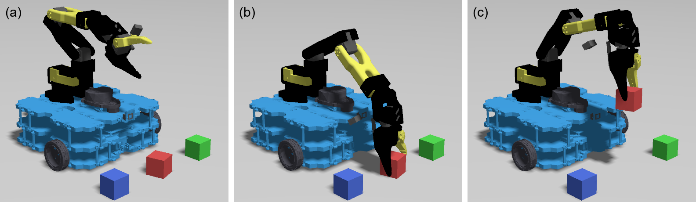
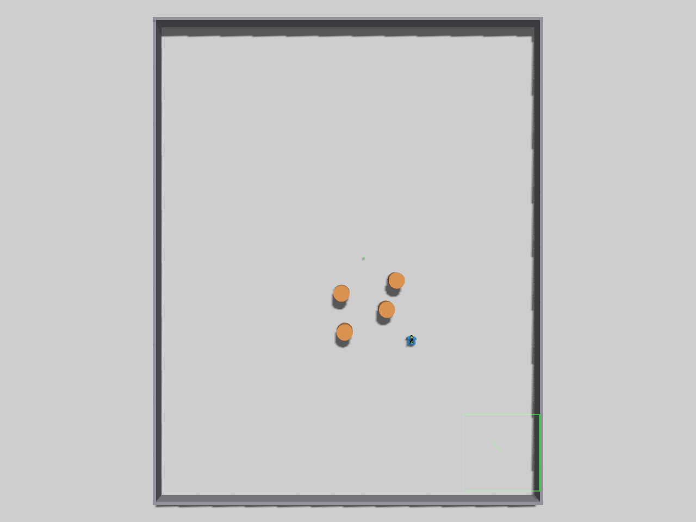
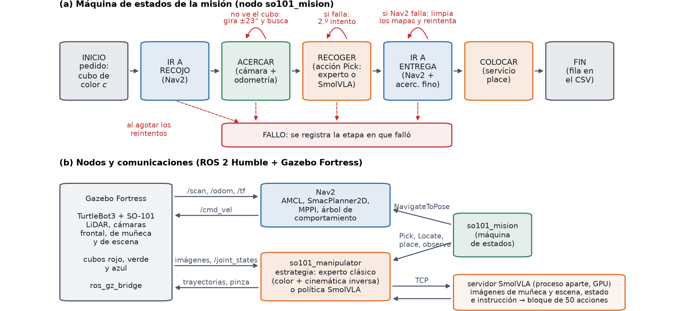
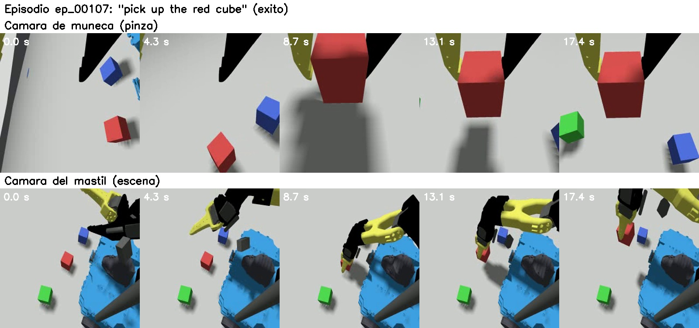
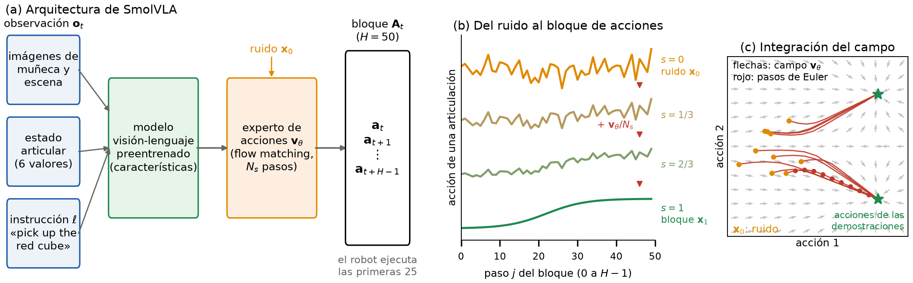
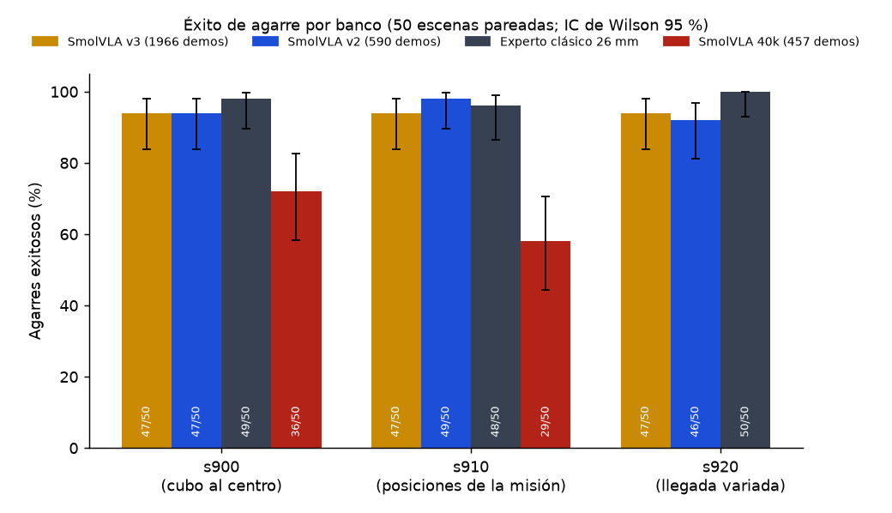
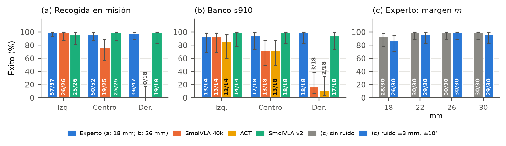
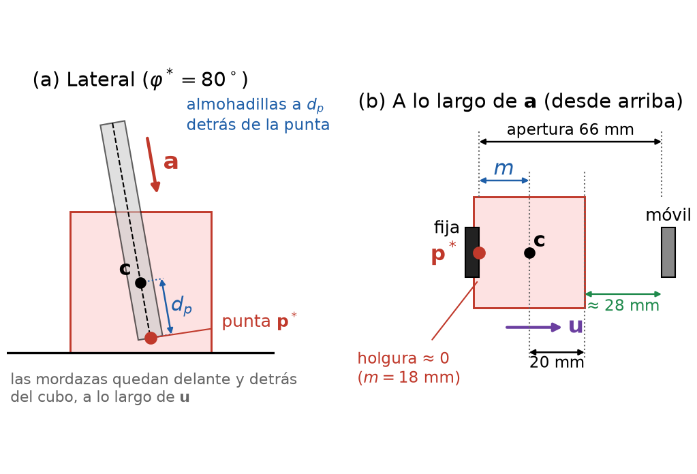

# Navegación autónoma y manipulación móvil con SmolVLA y SO-101 en simulación

Repositorio de código, configuraciones y datos del artículo:

> U. Rojas-Villanueva, P. Echevarria-Duran, V. Ventura-Condo, J. Rafael-Rafael y J. Quispe-Navarrete, «Navegación autónoma y manipulación móvil con SmolVLA y SO-101 en simulación» (*Autonomous Navigation and Mobile Manipulation with SmolVLA and SO-101 in Simulation*), *TECNIA*, Universidad Nacional de Ingeniería, Lima, Perú, 2026. Manuscrito en revisión en *TECNIA* (versión corregida, v25, enviada el 24-nov-2026); volumen, número, páginas y DOI se añadirán si se publica.

Filiaciones: Facultad de Ingeniería Eléctrica y Electrónica (Rojas-Villanueva, Echevarria-Duran), Facultad de Ciencias (Ventura-Condo, Quispe-Navarrete) y Facultad de Ingeniería Mecánica (Rafael-Rafael), Universidad Nacional de Ingeniería.

## Qué es

Un TurtleBot3 Waffle Pi con un brazo SO-101 en Gazebo Fortress (ROS 2 Humble). En la misión se pide un cubo por color (rojo, verde o azul): Nav2 (AMCL + SmacPlanner2D + MPPI) lleva la base a la zona de recojo, el brazo recoge el cubo y la base lo lleva a la zona de entrega, donde se deja en un plato. El agarre lo hace una de dos políticas intercambiables detrás de la misma acción ROS `Pick`:

- **experto clásico** (`ik_directa`): detección por color con la cámara de muñeca, cinemática inversa y agarre programado explícitamente; también genera las demostraciones;
- **política aprendida**: SmolVLA (`lerobot/smolvla_base` ajustado) o ACT, servidas por un proceso Python 3.12 aparte (LeRobot) por un socket TCP local.

Además se comparan los controladores locales de Nav2 (MPPI, DWB y RPP) con el mismo robot.

**Todo es simulación.** No hay ensayos con el robot físico.


*TurtleBot3 Waffle Pi con el brazo SO-101 en Gazebo, en tres momentos del agarre.*


*Arena de la misión: cilindros fijos, fila de tres cubos y plato de entrega.*


*Arquitectura: máquina de estados de la misión, nodos de ROS 2 y servidor de la política (Python 3.12) conectado por TCP.*


*Las dos cámaras que recibe la política: muñeca y escena (mástil), a lo largo de un episodio de demostración.*


*SmolVLA: el modelo visión-lenguaje procesa imágenes, estado e instrucción y el experto de acciones genera un bloque de acciones por flow matching.*

## Requisitos

| Componente | Versión |
|---|---|
| Sistema operativo | Ubuntu 22.04 |
| ROS 2 | Humble (Python 3.10) |
| Simulador | Gazebo Fortress (`ros_gz_sim`, `ros_gz_bridge`, `gz_ros2_control`) |
| Navegación | Nav2 (Humble): AMCL, SmacPlanner2D, MPPI, DWB, RPP |
| Políticas | LeRobot 0.6.1 (commit `7e241bd`), Python 3.12, PyTorch con CUDA |
| GPU usada | NVIDIA RTX 5080 (16 GB); el ajuste de SmolVLA usa 12-13 GB de VRAM con lote 32 |
| Análisis | Python ≥ 3.10 con `matplotlib`; `numpy` y `pandas` para `analisis/diagnostico_posicion/` y `analisis/analisis_derecha/` |
| Terceros | `turtlebot3_manipulation` (ROBOTIS, Apache-2.0) y el URDF/mallas del SO-101 (TheRobotStudio/SO-ARM100) |

ROS (Python 3.10) y LeRobot (Python 3.12) se mantienen en entornos separados; solo se comunican por TCP en `127.0.0.1:5555`.

## Estructura

```
ros2/                     paquetes ROS 2
  paper_vla_tb3so101/     robot, mundo, Nav2, experto, misión, banco del brazo, puente VLA, grabador
  paper_vla_interfaces/   acción Pick y servicio Locate
  tools/                  parar_sim.sh (cierra una simulación por dominio), prueba_sujecion.py (banco de la pinza)
orquestacion/
  vla/                    servidor de la política, conversión a LeRobotDataset, ajuste, evaluación, misiones y orquestadores nocturnos
  ablacion_cobertura/     ablación de cobertura de datos (preparada; no forma parte de los resultados del artículo)
  banco_pinza/            banco grabado de la pinza a 10 frente a 2 N·m
  ros_env.sh              entorno ROS usado en la estación de trabajo (ruta del proyecto en PROYECTO)
config/                   índice de configuraciones (Nav2, URDF) y parche del overlay de la pinza a 10 N·m
datos/                    CSV de todas las tandas (11-12nov, 14nov, 15nov, 16nov)
analisis/                 scripts que recalculan las cifras del artículo (Wilson, McNemar exacto y mid-p, Fisher, Newcombe, permutación)
docs/GUIA_V2_SO101.md     recetas de ejecución paso a paso
MANIFIESTO.md             manifiesto de datos: demostraciones, bancos, semillas, exclusiones, checkpoints
SHA256SUMS.txt            sumas SHA-256 de todos los archivos del repositorio
```

## Cómo reproducir las tablas y figuras desde los CSV

No hace falta ROS ni GPU: solo Python con `matplotlib`.

```bash
cd analisis
mkdir -p salidas
python resultados_v13.py          # -> salidas/res_v13.json y salidas/fig_v2_posicion_margen_v13.png
python navegacion/analizar_nav.py ../datos/16nov/navegacion_so101 > salidas/resumen_nav_so101.json
```

`resultados_v13.py` ejecuta en cadena `resultados_v10.py` → `resultados_v9.py` → `resultados_v8.py` (cada uno reutiliza el cálculo del anterior sin escribir sus salidas) y deja todas las cifras en `res_v13.json`, con claves del tipo `@@clave@@` que el generador del manuscrito sustituye en el texto. Se comprobó que el `res_v13.json` obtenido en este repositorio es idéntico (401 claves) al usado para el manuscrito v17, y que `analizar_nav.py` reproduce exactamente `datos/16nov/navegacion_so101/resumen_nav_so101.json`.

| Elemento del artículo (v25) | Origen | Claves / archivo |
|---|---|---|
| Bancos de agarre s900 y s910 (éxito, IC de Wilson, McNemar exacto y mid-p por escena pareada, éxito por posición del cubo) | `datos/16nov/eval_brazo_*.csv` | `bk_*`, `mc_*` |
| Tabla IV: misiones de las semillas 21-24 por etapa y política | `datos/14nov/final_misiones_vlapo40k_*`, `datos/16nov/final_misiones_*` | `mf_tabla`, `mf_*`, `pm_*`, `pmnav_*`, `pmcaida_*` |
| Tabla III: resumen por política (bancos y misión) | ídem | `bk_*`, `mf_*` |
| Tabla V: navegación MPPI / DWB / RPP | `datos/16nov/navegacion_so101/nav_so101_*.csv` y `.txt` | `resumen_nav_so101.json` (permutación con 20 000 remuestreos, semilla 1) |
| Carga de CPU frente a fallos de navegación (Spearman) | `datos/16nov/ESTADO_NOCHE15.txt` | `cpu_*` |
| Barrido del margen del experto (18/22/26/30 mm) | `datos/15nov/paso1_experto_m*_mision_s910.csv` | claves de la v9 en `res_v13.json`; figura, panel (c) |
| Ablación de acciones por inferencia (25/15/10) | `datos/15nov/eval_brazo_A7e2_40k_nacc*_n50_s900.csv` | claves de la v9 |
| Figura de recogida por posición y margen | todo lo anterior | `salidas/fig_v2_posicion_margen_v13.png` |
| Error lateral hacia la mordaza fija (lado derecho) | `datos/16nov/analisis_derecha/` | `analisis/analisis_derecha/` (necesita las trayectorias crudas; ver `MANIFIESTO.md`) |
| Control SmolVLA v3 (1966 demostraciones variadas, 60 000 pasos): bancos s900, s910 y s920, y recursos de cómputo | `datos/18nov/v3_variada/eval_*.csv`, `consumo_*.csv` | `RESULTADOS_V3.md` (47/50 en los tres bancos; sin diferencia con la v2; no evaluada en misiones completas) |
| Banco de la pinza 10 frente a 2 N·m | `datos/16nov/banco_pinza_10_vs_2Nm/` | `RESUMEN.txt`, `casos/*/traza.csv` |

Las cifras de la cadena histórica de la v8-v10 (SmolVLA 20k/40k con la pinza a 10 N·m, pinza reetiquetada, primeras misiones) salen de `datos/14nov/`; las tandas excluidas por carga de CPU están en `datos/14nov/afectadas_carga_14nov/` con su `LEEME.txt` y **no** entran en ningún cálculo.

## Cómo relanzar las simulaciones

Resumen; el detalle está en `docs/GUIA_V2_SO101.md`. Las rutas usan la variable `PROYECTO` (carpeta de trabajo con `colcon/`, `env/`, `vla/`, `demos/`; por defecto `~/proyecto/paper_rover_vla_2025`).

```bash
# 1) Compilar (fuera de cualquier workspace ajeno)
export PROYECTO=~/proyecto/paper_rover_vla_2025
mkdir -p $PROYECTO/colcon && cd $PROYECTO/colcon && source /opt/ros/humble/setup.bash
colcon build --base-paths <ruta_a_este_repo>/ros2 --packages-select paper_vla_interfaces paper_vla_tb3so101

# 2) Entorno LeRobot 0.6.1 (Python 3.12) en $PROYECTO/env
git clone https://github.com/huggingface/lerobot $PROYECTO/lerobot_src && git -C $PROYECTO/lerobot_src checkout 7e241bd
python3.12 -m venv $PROYECTO/env && $PROYECTO/env/bin/pip install -e "$PROYECTO/lerobot_src[smolvla]"

# 3) Misión con el experto (cada simulación en su propio ROS_DOMAIN_ID y GZ/IGN_PARTITION)
source orquestacion/ros_env.sh
ros2 launch paper_vla_tb3so101 cinematica.launch.py nav:=true controller:=mision rviz:=true
ros2 run paper_vla_tb3so101 so101_mision.py --n 20 --seed 21 --out misiones.csv

# 4) Corridas automáticas reanudables
bash orquestacion/vla/evaluar.sh <modelo> 50 vla,ik_directa eval.csv intentos/ eval.log 87 so101_foto     # banco del brazo, semilla 900
bash orquestacion/vla/mision.sh vla <modelo> 20 21 mis.csv intentos_mision/ mis.log 88 so101_mision        # misiones
bash orquestacion/vla/entrenar.sh <dataset> <repo_id> <salida> <pasos> <lote> <registro>                   # ajuste de SmolVLA
```

Reglas aprendidas que afectan a la validez de las medidas:

- no entrenar mientras se evalúa una política en la misma GPU (la inferencia pasa de ~40 a ~90 ms por bloque y empeora el agarre);
- máximo 2 simulaciones a la vez sin entrenamiento (o 1 durante un entrenamiento) en 40 vCPU: con más, MPPI no cumple 20 Hz («Control loop missed its desired rate») y Nav2 aborta cerca de la meta;
- cada simulación en paralelo necesita un `ROS_DOMAIN_ID` y una partición de Gazebo distintos.

## Resultados principales

Bancos de agarre pareados (50 escenas, misma escena para cada política; pinza a 2 N·m). s900: disposición de las demostraciones; s910: disposición de la misión.

| Política | s900 | s910 |
|---|---|---|
| Experto clásico, margen 18 mm | 44/50 (88 %) | — |
| Experto clásico, margen 26 mm | 49/50 (98 %) | 48/50 (96 %) |
| SmolVLA 40k (457 demostraciones) | 36/50 (72 %) | 29/50 (58 %); 3/18 con el cubo a la derecha |
| ACT 40k (457 demostraciones) | 33/50 (66 %) | 27/50 (54 %); 2/18 a la derecha |
| SmolVLA v2 30k (590 demostraciones con disposición de misión) | 47/50 (94 %) | 49/50 (98 %) |
| SmolVLA v3 60k (1966 demostraciones variadas, control) | 47/50 (94 %) | 47/50 (94 %) |

En el banco s920 (llegada variada) SmolVLA v3, SmolVLA v2 y el experto con 26 mm acertaron 47/50, 46/50 y 50/50; la v3 no se distingue de la v2 (McNemar p ≥ 0.625) y no se evaluó en misiones completas (`datos/18nov/v3_variada/`).




*Recogida según la posición del cubo en la fila y el margen lateral del experto (figura del artículo).*


*Geometría del agarre: mordaza fija y móvil; los fallos a la derecha se asocian a un error lateral hacia la mordaza fija.*

Misiones completas, semillas 21-24 (80 misiones por política, mismas misiones para todas):

| Política | Misión completa | IC 95 % (Wilson) | Completa si levantó el cubo |
|---|---|---|---|
| Experto, 18 mm | 71/80 (89 %) | 80-94 % | 71/74 |
| SmolVLA 40k | 45/80 (56 %) | 45-67 % | 45/45 |
| SmolVLA, pinza reetiquetada | 48/80 (60 %) | 49-70 % | 48/49 |
| Experto, 26 mm | 57/80 (71 %) | 61-80 % | 57/70 (12 cubos caídos en el transporte) |
| SmolVLA v2 | 59/80 (74 %) | 63-82 % | 59/69 |

Navegación con los parámetros por defecto (meta a (2.0, 1.5) m, 30 ensayos planificados por controlador, cada uno con simulación nueva; válidos: 30, 28 y 29; éxito = llegada informada y error planar real ≤ 0.30 m):

| Controlador | Éxito | Tiempo (s) | Error final (m) | Holgura mínima (m) |
|---|---|---|---|---|
| MPPI | 29/30 | 11.75 ± 1.96 | 0.176 ± 0.006 | 0.102 ± 0.004 |
| DWB | 27/28 | 10.99 ± 0.39 | 0.198 ± 0.005 | −0.001 ± 0.004 (roza el cilindro) |
| RPP | 29/29 | 16.39 ± 4.09 | 0.174 ± 0.006 | 0.100 ± 0.011 |

## Limitaciones

- Solo simulación (Gazebo Fortress): una arena, obstáculos fijos, un tipo de objeto (cubos de 4 cm) y tres colores; no se generaliza a un robot físico ni a otros entornos.
- 50 escenas pareadas solo detectan diferencias amplias; las misiones de la segunda ronda son una tanda por semilla.
- La pinza del SO-101 es de control por posición: el par real lo fija el límite del URDF. Con 10 N·m Gazebo genera fuerzas de contacto espurias que hacen girar al robot; las demostraciones de la primera ronda se grabaron a 10 N·m y la evaluación usa 2 N·m.
- Los cubos quedan por debajo del plano del LiDAR y no están en el mapa de costos.
- El experto centra el objetivo antes del agarre, así que no se evalúa la comprensión del lenguaje.
- La localización y el control solo usan sensores simulados (LiDAR, odometría, cámaras); la verdad de terreno de Gazebo solo se usa para medir.
- La dependencia `turtlebot3_manipulation` (ROBOTIS) no se incluye: se clona del repositorio oficial (ver `MANIFIESTO.md`, sección 10). Los datasets, checkpoints y videos se publican aparte (secciones 8 y 9).

## Licencias

- **Código** (`ros2/`, `orquestacion/`, `analisis/`, `config/`): Apache License 2.0 (`LICENSE`), compatible con LeRobot y con los paquetes de ROBOTIS.
- **Datos** (`datos/`) y **documentación** (`README.md`, `MANIFIESTO.md`, `docs/`): Creative Commons Attribution 4.0 International (`LICENSE-DATOS`).
- Los componentes de terceros (URDF y mallas del SO-101, `turtlebot3_manipulation`, `lerobot/smolvla_base`) conservan sus licencias originales.


## Cómo citar

```bibtex
@article{rojas2026smolvla,
  author  = {Rojas-Villanueva, Uwe and Echevarria-Duran, Patrick and Ventura-Condo, Viviana and Rafael-Rafael, Jose and Quispe-Navarrete, Johan},
  title   = {Navegación autónoma y manipulación móvil con SmolVLA y SO-101 en simulación},
  journal = {TECNIA},
  year    = {2026},
  note    = {Manuscrito en revisión}
}
```

---

## Summary (English)

Code, configurations and data for the paper *Autonomous Navigation and Mobile Manipulation with SmolVLA and SO-101 in Simulation* (TECNIA, Universidad Nacional de Ingeniería, 2026). A TurtleBot3 Waffle Pi with an SO-101 arm runs a color-ordered pick-and-place mission in Gazebo Fortress with ROS 2 Humble and Nav2; grasping is done either by a hand-programmed classical expert or by a learned policy (SmolVLA fine-tuned with LeRobot 0.6.1, or ACT). The repository contains the ROS 2 packages, orchestration scripts, all per-trial CSV files and the analysis scripts that recompute every number of the paper (`cd analisis && python resultados_v13.py`, no ROS or GPU needed). Everything is simulation-only. Code is Apache-2.0; data and documentation are CC BY 4.0.
